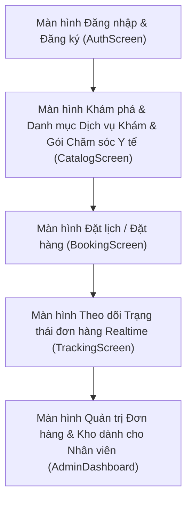

# ĐẶC TẢ TRẢI NGHIỆM GIAO DIỆN (UI/UX SPECIFICATIONS)
**Dự án:** HealthClinicApp

## 1. SƠ ĐỒ ĐIỀU HƯỚNG MÀN HÌNH (NAVIGATION FLOW)

## 2. DANH SÁCH MÀN HÌNH
- **Màn hình Đăng nhập & Đăng ký (AuthScreen)**
- **Màn hình Khám phá & Danh mục Dịch vụ Khám & Gói Chăm sóc Y tế (CatalogScreen)**
- **Màn hình Đặt lịch / Đặt hàng (BookingScreen)**
- **Màn hình Theo dõi Trạng thái đơn hàng Realtime (TrackingScreen)**
- **Màn hình Quản trị Đơn hàng & Kho dành cho Nhân viên (AdminDashboard)**
